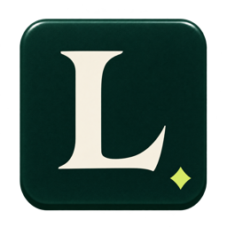

<p align="center"></p>

# Lettrine

Laboratoire local de stratégie pour jeux de lettres. Le studio explore 128 000 duels en quatre langues, les archives de maîtres, les variantes de placement et la progression du bot adaptatif N A B. Le prototype Android reste disponible pendant le chantier de recherche.

## Ouvrir sur le Mac

Avec Docker Desktop, Python 3 et `zstd` disponibles, lancer depuis ce dossier.

```sh
./tools/start.sh
```

Le premier démarrage charge l’archive fournie dans PostgreSQL. Ouvrir [Lettrine Studio](http://127.0.0.1:8787). Le tableau de bord affiche les cotes, les confrontations, les mots fréquents et les archives. **Parties** permet de filtrer Expert × Expert, de rejouer coup par coup, de regarder un duel généré ou d’examiner les alternatives. **Administration** permet d’importer du JSON ou du JSONL, de télécharger les journaux et de récupérer l’APK.

Ollama tourne sur le Mac. Les deux modèles sont requis pour le commentaire de position et la recherche sémantique.

```sh
ollama pull llama3.2:3b
ollama pull qwen3-embedding:0.6b
```

Gemma, Llama et Qwen ont été comparés sur des duels appariés. Les autres fonctions du studio restent disponibles si Ollama est arrêté. Le port Web se règle avec `LETTRINE_PORT`. Les ports PostgreSQL et Redis restent internes au projet Docker.

## Prototype Android

[Télécharger l’APK](android/artifacts/lettrine.apk) · [Télécharger depuis le studio](http://127.0.0.1:8787/download/lettrine.apk) · [Guide Android et compilation](android/README.md)

Le prototype conserve le jeu hors ligne à deux, trois ou quatre sur un appareil, le duel Bluetooth et le solo. L’app garde l’historique et la cote locale, exporte ses parties en JSON et propose zoom, palettes et ambiance musicale optionnelle.

## Laboratoire

| Mesure | Résultat |
| --- | ---: |
| Duels de référence dans PostgreSQL | 128 000, dont 100 000 en français |
| Expert × Expert | 10 000 |
| Elo relatifs Découverte / Initié / Stratège / Expert | 748 / 1 016 / 1 409 / 1 627 |
| Expert entraîné contre Expert de référence sur 12 000 duels réservés | 51,93 % des points de match · +13 Elo |
| Recherche avancée face à l’Expert entraîné | 55,58 % des points sur 2 000 duels réservés |
| Calibration adaptative FR et EN | 24 000 duels par langue |
| Cotes humaines historiques sourcées | 44 relevés, échelles fédérales distinctes |

L’analyse de position énumère les placements légaux puis compare les principales options sur trois demi-coups, en échantillonnant le sac et le chevalet adverse. Llama intervient dans le commentaire. Le banc d’essai séparé compare Llama et Qwen quand ils choisissent parmi des coups légaux fournis par le moteur. La recherche sémantique indexe les documents et une sélection de positions dans pgvector.

```sh
cargo test --release
cargo run --release -- profiles
cargo run --release -- run
cargo run --release -- train
cargo run --release -- benchmark-llm 6
LETTRINE_ELITE=1 cargo run --release -- export jsonl > experts.jsonl
```

Le moteur français embarque Grammalecte 7.7. Le comparateur fournit un audit des écarts à partir d’un fichier ODS autorisé. Les profils anglais WESPA, allemand SDeV et russe Mattel chargent leurs distributions et lexiques ouverts, avec des campagnes séparées. La variante japonaise est documentée. Les cotes sont propres au profil, au lexique et aux stratégies testés.

## Documentation

- [Architecture et API](docs/ARCHITECTURE.md)
- [Règles, lexique français et comparaison ODS](data/fr/README.md)
- [Campagne et résultats](docs/RESULTATS.md) · [Archive des 100 000 duels](data/campaign/README.md)
- [Entraînement, Elo et recherche](docs/ENTRAINEMENT.md)
- [Profils de langues](docs/LANGUES.md)
- [Archives humaines et provenance](data/expert/README.md)
- [Comparatif Android](docs/COMPARATIF_ANDROID.md)

- [Modèles Ollama et projet mobile](docs/CHOIX_MODELES.md)
- [Histoire, maîtres et archives](docs/HISTOIRE_ET_MAITRES.md)
- [Sécurité locale et suite produit](docs/SECURITE_ET_SUITE.md)

Code sous [AGPL-3.0](LICENSE). Les données Grammalecte et les polices ont leurs propres notices. Lettrine est un projet indépendant.
