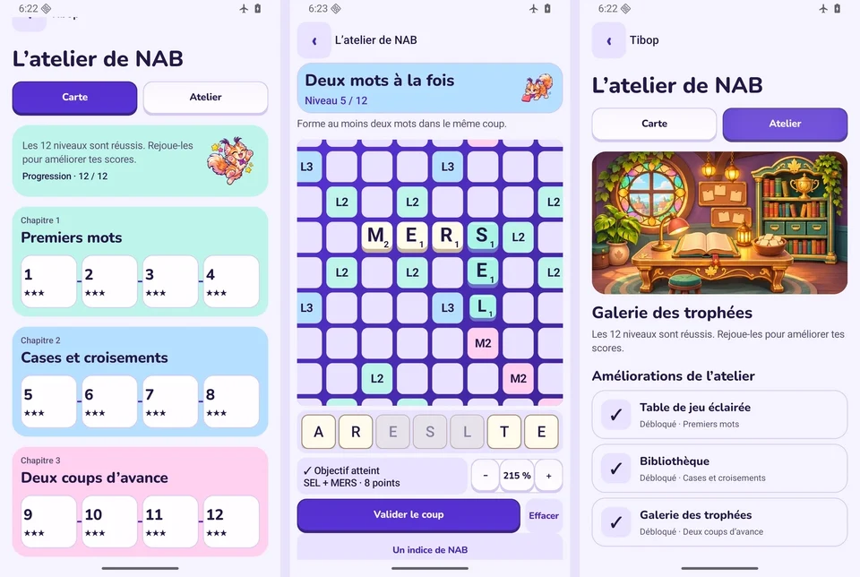
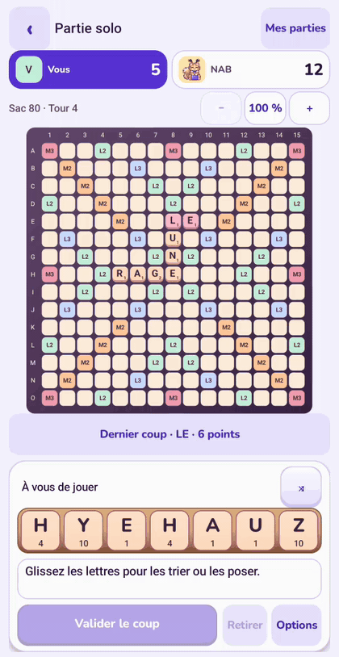
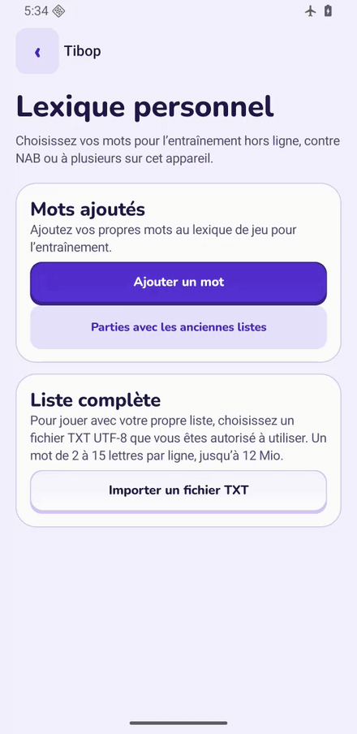

<p align="center">
  
</p>

<h1 align="center">Tibop</h1>

<p align="center">Relevez douze défis de lettres, transformez l’atelier de NAB et affrontez le Maine Coon dans des parties classiques sur Android. Jouez en français ou en anglais, même hors ligne.</p>

<p align="center">
  <strong><a href="https://github.com/nabz0r/Tibop/releases/download/v0.17.0/Tibop-0.17.0.apk">Télécharger Tibop 0.17.0</a></strong> ·
  <a href="https://nabz0r.github.io/Tibop/">Page de la bêta</a> ·
  <a href="android/README.md">Guide Android</a> ·
  <a href="#tibop-studio">Studio sur Mac</a>
</p>

<p align="center">
  Android 8 et versions ultérieures · Jeu hors ligne en mode invité
</p>

<p align="center">
  <a href="docs/media/tibop-atelier.webp"></a>
</p>

## Aperçus Android

### L’atelier de NAB

Captures prises dans Tibop **0.17.0**. Aux niveaux 4, 8 et 12, dépassez le score de NAB pour éclairer la table de jeu, aménager la bibliothèque, puis ouvrir la galerie des trophées.

[Carte des douze niveaux](docs/media/tibop-atelier-carte.webp) · [Deux mots en un coup](docs/media/tibop-atelier-croisement.webp) · [Finale du chapitre 2 en vidéo](docs/media/tibop-atelier-gameplay.mp4) · [Galerie des trophées](docs/media/tibop-atelier-galerie.webp)

### Jeu classique et entraînement

Les captures suivantes ont été enregistrées dans Tibop **0.16.7**.

#### Partie solo avec des skins

Le plateau et les tuiles **Aurore** sont équipés avec le chevalet **Érable**. Le GIF montre la pose, la validation du coup et la réponse de NAB. [Voir les skins en pleine partie](docs/media/tibop-skins-en-partie.webp)

<p align="center">
  <a href="docs/media/tibop-gameplay-solo.gif"></a>
</p>

#### Ajouter puis jouer `OK`

Dans **Lexique personnel**, ajoutez `OK`, puis ouvrez **Jouer avec mes mots**. Sur ce tirage d’exemple, la pose rapporte **22 points** en entraînement local. [Voir le coup validé](docs/media/tibop-ok-en-partie.webp)

<p align="center">
  <a href="docs/media/tibop-ajouter-jouer-ok.gif"></a>
</p>

[Défi du jour en animation](docs/media/tibop-defi-quotidien.gif)

## Jouer sur Android

- **L’atelier de NAB** propose douze niveaux courts, en français et en anglais. En un ou deux coups, atteignez un objectif de placement ou de score. Aux niveaux 4, 8 et 12, battez le score de NAB pour agrandir l’atelier. L’accès est libre et chaque langue garde ses records. [L’atelier de NAB](android/README.md#latelier-de-nab)
- **Partie classique** lance une partie solo contre NAB ou reprend celle en cours. Choisissez l’un des quatre niveaux fixes ou laissez le mode adaptatif ajuster la difficulté pendant la partie. Le bouton **EN / FR** change les menus et le lexique. Chaque langue garde sa progression.
- **À plusieurs**, passez le téléphone à deux, trois ou quatre ou jouez en duel Bluetooth. En ligne, ouvrez **Amis** pour rejoindre un serveur de bêta, jouer un duel à un coup chacun, demander une revanche miroir ou participer au tournoi du week-end. [Accès à la bêta et invitations](android/README.md#amis-et-duels-en-bêta)
- **En quelques minutes**, jouez le défi du jour, essayez de placer deux mots avec un même chevalet dans *Deux coups d’avance*, ou améliorez votre record sur les trois parcours du circuit bonus.
- **Collection** réunit les plateaux, les chevalets, les tuiles et les cartes de score. L’aperçu montre vos choix ensemble avant de reprendre une partie. [Personnaliser le jeu](android/README.md#personnaliser-le-jeu)
- **Définition** ouvre une fiche hors ligne pour les mots couverts. Pour les verbes français, la fiche peut retrouver l’infinitif, le temps et la personne. [Sources et couverture](android/README.md#consulter-une-définition)

Glissez les tuiles de gauche à droite dans le chevalet pour essayer un mot. Pour le jouer, glissez les tuiles sur le plateau ou touchez une lettre puis une case. Le jeu affiche les mots formés et les points avant validation. Agrandissez le plateau si besoin et parcourez ses cases avec TalkBack.

**Grammalecte 7.7 · Classique** filtre 258 formes, dont `KM`, `KG` et `HLM`. Il s’applique aux nouvelles parties solo et locales, aux nouveaux défis français et aux nouveaux duels entre deux joueurs à jour. Les parties en cours et les liens de défi déjà partagés gardent leur lexique. Les invitations d’amitié restent utilisables. [Lexique français et exclusions](data/fr/README.md#lexique-des-nouvelles-parties-classiques-sur-android)

### Revoir vos coups

En fin de partie, NAB peut mettre un coup à revoir en évidence avec les cases, le gain de points et le chevalet d’origine. **Nouvelle partie** relance le même mode. Dans **Historique**, revenez à chaque tour, suivez votre Elo local ou exportez vos parties en JSON. Le **Bilan avec NAB** compare jusqu’à trois tours à d’autres placements.

**Expliquer ce coup** affiche immédiatement le score et son premier détail vérifié, même en mode avion. Ouvrez les autres détails pour lire les mots croisés, les primes ou le rôle des jokers. Sur demande, SmolLM2 135M Instruct Q4_0 sélectionne un détail à mettre en avant. Le moteur Android joue les coups de NAB et calcule les scores. [Modèle, empreinte et licences](android/app/src/main/assets/SmolLM2-NOTICE.md)

[Essai sur téléphone](android/README.md#tester-la-bêta-sur-son-téléphone) · [Vérifications de Tibop 0.17.0](docs/SIMULATIONS_ANDROID.md#vérification-de-tibop-0170) · [Mesures du modèle embarqué](docs/SIMULATIONS_ANDROID.md#mesures-du-modèle-embarqué)

### Garder votre progression

- **Profil → Réglages → Sauvegarder et transférer** crée un fichier ZIP avec les parties, l’historique et la progression locale des deux langues, atelier compris. Gardez-le dans un dossier accessible pour pouvoir le restaurer sur une autre installation. [Ce que contient la sauvegarde](android/README.md#transférer-sa-progression)
- **Profil → Réglages → Lexique personnel** ajoute des mots à la main ou importe une liste TXT autorisée pour l’entraînement contre NAB ou à plusieurs sur le même appareil. Chaque liste a son propre historique. [Ajouter des mots ou importer une liste](android/README.md#jouer-avec-un-lexique-personnel)

## Tibop Studio

Le studio local permet de rejouer des parties, de comparer les placements et d’examiner les résultats de **128 000 duels de référence**, dont 100 000 en français. Le jeu web permet aussi d’ouvrir un salon privé pour deux à quatre joueurs sur le même réseau.

Sur le Mac, installez Docker Desktop, Python 3 et `zstd`, puis lancez le studio depuis le dépôt.

```sh
./tools/start.sh
```

Le premier démarrage charge les campagnes fournies. [Ouvrir le studio sur le Mac](http://127.0.0.1:8787/index.html) · [Ouvrir les salons](http://127.0.0.1:8787/) · [Architecture et API](docs/ARCHITECTURE.md)

<p align="center">
  <a href="docs/media/duel-en-direct.png"></a>
</p>

### Ce que le laboratoire mesure

Le dernier test sur **Lettres en vrac** a comparé deux réglages de NAB Recherche avancée contre Macondo v0.13.9 configuré pour maximiser le score immédiat. Chaque réglage a joué **1 000 nouvelles parties** à partir des mêmes 500 tirages, dans les deux ordres de départ. Le banc applique une pendule de 20 minutes et les procédures de contestation du Scrabble classique FISF.

| NAB contre Macondo | Victoires · nulles · défaites | Points de match |
| --- | ---: | ---: |
| Réglage de base | 630 · 1 · 369 | **63,05 %** |
| Réglage sélectionné contre Macondo, 22 coups présélectionnés | 626 · 1 · 373 | **62,65 %** |

L’écart apparié est de **−0,40 point de pourcentage** (IC à 95 % de −1,73 à +0,93). L’essai ne montre pas de gain sur les tirages réservés. La mesure concerne le moteur du laboratoire. Dans Tibop, l’Elo se calcule à partir des parties solo cotées sur l’appareil. [Protocole et résultats détaillés](docs/SIMULATION_FISF.md) · [Entraînement et Elo](docs/ENTRAINEMENT.md)

## Compiler et vérifier

Pour compiler l’APK sur le Mac, installez Java 17, Python 3, le SDK Android 36, le NDK `28.2.13676358`, CMake et Ninja.

```sh
./android/scripts/build.sh
(cd android && ./gradlew :app:testDebugUnitTest :app:lintDebug)
cargo test --locked
```

[Compilation, signature et installation](android/README.md#compiler-sur-le-mac) · [Préparer un bundle Google Play](android/README.md#préparer-un-bundle-google-play) · [Simulations Android](docs/SIMULATIONS_ANDROID.md)

### Aller plus loin

- [Campagnes et résultats](docs/RESULTATS.md) · [Archive des 100 000 duels français](data/campaign/README.md) · [Profils et lexiques](docs/LANGUES.md)
- [Archives de maîtres et sources](data/expert/README.md) · [Règles et comparaison ODS](data/fr/README.md) · [Banc des modèles de langage](docs/CHOIX_MODELES.md)
- [Comparatif Android](docs/COMPARATIF_ANDROID.md) · [Récompenses Android](docs/ECONOMIE_ANDROID.md) · [Sécurité locale](docs/SECURITE_ET_SUITE.md)

Tibop est un projet indépendant sous [AGPL-3.0](LICENSE). Les lexiques, le modèle embarqué et les polices ont leurs propres licences.
