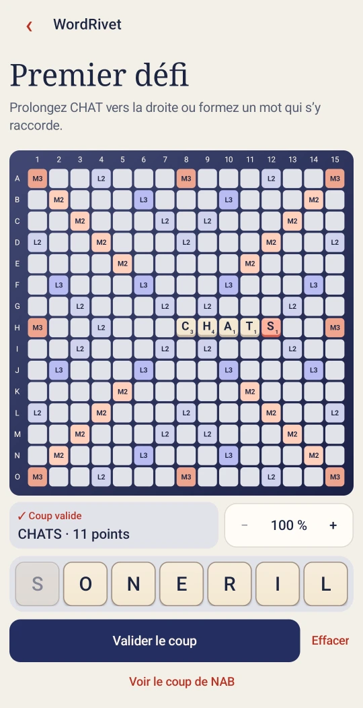
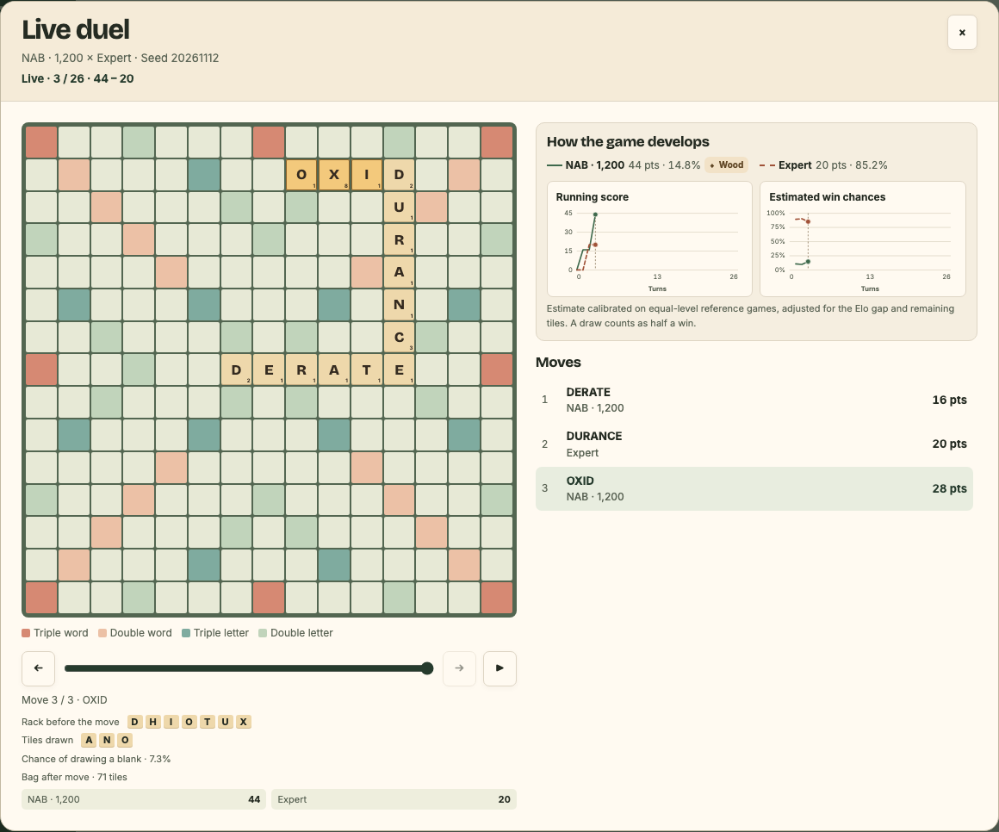

<p align="center">
  
</p>

<h1 align="center">WordRivet</h1>

<p align="center">Le jeu de lettres de Lettrine pour Android. Affrontez NAB en français ou en anglais et revenez sur vos meilleurs coups.</p>

<p align="center">
  <strong><a href="https://raw.githubusercontent.com/nabz0r/scrabnble/main/android/artifacts/lettrine.apk">Télécharger l’APK 0.15.3</a></strong> ·
  <a href="android/README.md">Guide Android</a> ·
  <a href="#lettrine-studio">Studio sur Mac</a>
</p>

<p align="center">
  Android 8 et versions ultérieures · Jeu hors ligne en mode invité
</p>

<p align="center">
  
</p>

## Jouer sur Android

- **En solo**, choisissez l’un des quatre niveaux de NAB ou laissez le mode adaptatif ajuster la difficulté pendant la partie. Le bouton **EN / FR** change les menus et le lexique. Chaque langue garde sa progression.
- **En quelques minutes**, jouez le défi du jour, essayez de placer deux mots avec un même chevalet dans *Deux coups d’avance*, ou améliorez votre record sur les trois parcours du circuit bonus.
- **À plusieurs**, passez le téléphone à deux, trois ou quatre ou jouez en duel Bluetooth. En ligne, ouvrez **Amis** pour rejoindre un serveur de bêta, jouer un duel à un coup chacun, demander une revanche miroir ou participer au tournoi du week-end. [Accès à la bêta et invitations](android/README.md#amis-et-duels-en-bêta)

Sur le plateau, glissez une tuile ou touchez une lettre puis une case. Le jeu affiche les mots formés et les points avant validation. Agrandissez le plateau si besoin et parcourez ses cases avec TalkBack.

<p align="center">
  
</p>

### Revoir vos coups

Dans **Historique**, rejouez la partie coup par coup, suivez votre progression Elo locale et exportez vos parties en JSON. Le **Bilan avec NAB** compare jusqu’à trois coups à une autre possibilité. Lorsque le chevalet du tour est disponible, vous pouvez rejouer la position.

**Expliquer ce coup** affiche immédiatement le score et son premier détail vérifié, même en mode avion. Ouvrez les autres détails pour lire les mots croisés, les primes ou le rôle des jokers. Sur demande, SmolLM2 135M Instruct Q4_0 sélectionne un détail à mettre en avant. Le moteur Android joue les coups de NAB et calcule les scores. [Modèle, empreinte et licences](android/app/src/main/assets/SmolLM2-NOTICE.md)

[Essai de bout en bout sur Android](android/README.md#vérification-de-la-version-0153) · [Mesures du modèle embarqué](docs/SIMULATIONS_ANDROID.md#vérifier-wordrivet-0152-sur-android)

### Garder votre progression

- **Profil → Réglages → Sauvegarder et transférer** crée un fichier ZIP avec les parties, l’historique et la progression locale des deux langues. Gardez-le dans un dossier accessible pour pouvoir le restaurer sur une autre installation. [Ce que contient la sauvegarde](android/README.md#transférer-sa-progression)
- **Profil → Réglages → Lexique personnel** importe un fichier TXT UTF-8 autorisé, puis ouvre l’entraînement contre NAB ou à plusieurs sur le même appareil. Chaque liste a son historique propre. Les parties habituelles utilisent Grammalecte 7.7 en français et ENABLE2K en anglais. [Format et fonctionnement de l’import](android/README.md#jouer-avec-un-lexique-personnel)

## Lettrine Studio

Le studio local permet de rejouer des parties, de comparer les placements et d’examiner les résultats de **128 000 duels de référence**, dont 100 000 en français. Le jeu web permet aussi d’ouvrir un salon privé pour deux à quatre joueurs sur le même réseau.

Sur le Mac, installez Docker Desktop, Python 3 et `zstd`, puis lancez le studio depuis le dépôt.

```sh
./tools/start.sh
```

Le premier démarrage charge les campagnes fournies. [Ouvrir le studio sur le Mac](http://127.0.0.1:8787/index.html) · [Ouvrir les salons](http://127.0.0.1:8787/) · [Architecture et API](docs/ARCHITECTURE.md)

<p align="center">
  
</p>

### Ce que le laboratoire mesure

Le dernier test sur **Lettres en vrac** a comparé deux réglages de NAB Recherche avancée contre Macondo v0.13.9 configuré pour maximiser le score immédiat. Chaque réglage a joué **1 000 nouvelles parties** à partir des mêmes 500 tirages, dans les deux ordres de départ. Le banc applique une pendule de 20 minutes et les procédures de contestation du Scrabble classique FISF.

| NAB contre Macondo | Victoires · nulles · défaites | Points de match |
| --- | ---: | ---: |
| Réglage de base | 630 · 1 · 369 | **63,05 %** |
| Réglage sélectionné contre Macondo, 22 coups présélectionnés | 626 · 1 · 373 | **62,65 %** |

L’écart apparié est de **−0,40 point de pourcentage** (IC à 95 % de −1,73 à +0,93). L’essai ne montre pas de gain sur les tirages réservés. La mesure concerne le moteur du laboratoire. Dans WordRivet, l’Elo se calcule à partir des parties solo cotées sur l’appareil. [Protocole et résultats détaillés](docs/SIMULATION_FISF.md) · [Entraînement et Elo](docs/ENTRAINEMENT.md)

## Compiler et vérifier

Pour compiler l’APK sur le Mac, installez Java 17, Python 3, le SDK Android 36, le NDK `28.2.13676358`, CMake et Ninja.

```sh
./android/scripts/build.sh
(cd android && ./gradlew :app:testDebugUnitTest :app:lintDebug)
cargo test --locked
```

[Compilation, signature et installation](android/README.md#compiler-sur-le-mac) · [Bundle Android pour la bêta Google Play](android/artifacts/lettrine.aab) · [Simulations Android](docs/SIMULATIONS_ANDROID.md)

### Aller plus loin

- [Campagnes et résultats](docs/RESULTATS.md) · [Archive des 100 000 duels français](data/campaign/README.md) · [Profils et lexiques](docs/LANGUES.md)
- [Archives de maîtres et sources](data/expert/README.md) · [Règles et comparaison ODS](data/fr/README.md) · [Banc des modèles de langage](docs/CHOIX_MODELES.md)
- [Comparatif Android](docs/COMPARATIF_ANDROID.md) · [Récompenses Android](docs/ECONOMIE_ANDROID.md) · [Sécurité locale](docs/SECURITE_ET_SUITE.md)

Lettrine est un projet indépendant sous [AGPL-3.0](LICENSE). Les lexiques, le modèle embarqué et les polices ont leurs propres licences.
