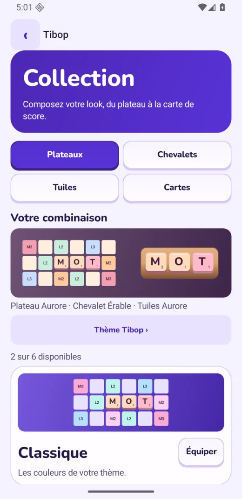

# Tibop pour Android

[Tibop 0.17.0](https://github.com/nabz0r/Tibop/releases/tag/v0.17.0) est la bêta Android avec NAB le Maine Coon. Le jeu fonctionne en invité hors ligne à partir d’Android 8 (API 26). La bêta conserve l’identifiant Android et la signature des éditions distribuées en APK direct.

## Tester la bêta sur son téléphone

1. Sur Android, [téléchargez Tibop 0.17.0](https://github.com/nabz0r/Tibop/releases/download/v0.17.0/Tibop-0.17.0.apk) et ouvrez le fichier. Si Android le demande, autorisez l’installation depuis le navigateur ou l’application Fichiers. Gardez la bêta précédente installée et choisissez **Mettre à jour** pour conserver vos parties et votre progression.
2. Depuis l’accueil, ouvrez **L’atelier de NAB**. Jouez les quatre premiers niveaux pour aménager la table de jeu éclairée. Passez en anglais avec **EN** pour retrouver un parcours distinct.
3. En français, ouvrez **Jouer contre NAB** ou **Jouer à deux ou plus** et démarrez une nouvelle partie. Faites glisser une tuile du chevalet sur une autre pour déplacer la première. Faites ensuite glisser une tuile sur le plateau. Quittez l’application en cours de tour et touchez **Reprendre ma partie** pour retrouver l’ordre des lettres et le brouillon.
4. Pour tester le lexique, si le tirage le permet, essayez `KM` ou `KG` sur la case centrale, puis un mot courant comme `AS` ou `CHAT`. Le jeu indique le motif du refus ou le score du coup. Le filtre s’applique aux nouvelles parties classiques en français.
5. Pour un duel avec le lexique filtré, installez tous les deux la mise à jour et ouvrez **Amis** pour vous connecter avant de lancer un nouveau duel. Les liens d’amitié déjà envoyés s’utilisent comme avant.

## Jouer

- Depuis **L’atelier de NAB**, touchez **Continuer · Niveau N** pour entrer directement dans le niveau en cours, ou **Carte** pour parcourir les douze niveaux. Quitter un niveau ramène à la carte. [L’atelier de NAB](#latelier-de-nab)
- La carte **Partie classique** affiche **Reprendre ma partie** lorsqu’une partie est en cours, ou **Jouer contre NAB**. L’accueil propose ensuite **Jouer à deux ou plus**, **Mes parties** et le **Défi du jour**, suivi de **Deux coups d’avance** et du circuit. Retrouvez Bluetooth, **Premier défi** et **Comment jouer** sous **Autres modes**.
- **EN / FR** sur l’accueil ou **Profil → Réglages → Langue du jeu** change la langue des menus et celle du plateau. Le français est la langue initiale. Les sauvegardes, historiques, cotes, séries, records et sessions sociales sont propres à chaque langue. Les parties françaises précédentes sont accessibles en français.
- **Défi du jour** propose une nouvelle position selon la date locale, même en mode avion. Validez un coup légal pour compter la journée dans votre série. Vous pouvez rejouer pour améliorer le record du jour.
- **Deux coups d’avance / Two Moves Ahead** ouvre douze positions hors ligne par langue. Le premier placement reste sur le plateau et vous jouez le second avec les tuiles restantes. Le résultat cumule les deux coups. NAB donne un indice et rejoue une séquence en deux temps sur le plateau. Le record de chaque défi est enregistré sur l’appareil.
- **Circuit bonus / Bonus Circuit** propose neuf positions par langue, réparties en trois parcours. Chaque nouveau parcours prend la suite du précédent. Après le troisième, la rotation recommence. La première entrée est offerte sur l’appareil. Un ticket couvre ensuite le circuit complet, y compris sa reprise. La réserve de trois tickets gratuits récupère un ticket toutes les deux heures. Les pièces et tickets sont communs aux deux langues, et chaque circuit se reprend dans sa langue. La vidéo facultative de démonstration ouvre un ticket par jour.
- Gagnez **25 pièces** sur le défi du jour, **50** à la première réussite de chaque défi du catalogue et **75** sur une coupe terminée. Échangez **100 pièces** contre un ticket dans le circuit ou débloquez les thèmes **Nuit indigo** et **Coquelicot** dans les réglages. Les achats en argent réel sont désactivés. Le circuit conserve son meilleur score dans chaque langue. Si le deuxième coup est impossible, le jeu propose de reprendre le premier.
- Le parrainage crédite un ticket à un nouveau joueur après le premier duel terminé avec son parrain. Le parrain peut obtenir trois tickets de parrainage par mois et par compte social. Le crédit apparaît au prochain chargement de **Amis** ou du duel.
- **Bats mon score** partage une carte PNG avec la date, le score et, lorsqu’elle s’applique, la série. Le lien associé mène à la [page d’invitation](https://nabz0r.github.io/Tibop/defi/). L’application ouvre la langue et la position du défi, puis compare le coup du destinataire au score partagé. **Copier le lien** est disponible pour les messageries qui séparent les images du texte. Une invitation pour une autre date se joue hors série.
- **Profil** réunit le pseudo, la photo, le pays, l’âge et le sexe, tous facultatifs. Les exploits se débloquent à partir de vos parties et de vos défis. La photo, le pays, l’âge et le sexe restent sur cet appareil.
- **Amis** propose une invitation à usage unique, des duels à un coup sur un plateau commun, la revanche et un classement calculé sur les duels terminés entre membres de votre cercle d’amis. Chaque joueur peut annuler un duel en cours pour les deux participants. Touchez **Actualiser** pour revoir l’état d’un duel en attente après une coupure. Si le duel est devenu indisponible, **Retour aux duels** recharge la liste. Une fois les deux coups envoyés, le résultat permet de comparer les scores et les placements sur le plateau.
- **Notifications de tour** s’active dans **Amis** ou **Profil → Réglages**. Touchez l’alerte pour retrouver le duel. Une seule alerte est émise par duel en attente. Tibop vérifie les espaces FR et EN dans lesquels un compte est déjà connecté. Toucher une alerte ouvre le duel dans sa langue. Le délai en arrière-plan peut dépasser 15 minutes selon les réglages de batterie d’Android. [Planification Android](https://developer.android.com/reference/androidx/work/PeriodicWorkRequest)
- **Revanche miroir** apparaît après un duel terminé où chacun avait un chevalet distinct. Rejouez sur le même plateau, chacun avec le chevalet que son ami avait au premier duel. Le résultat affiche aussi le cumul des deux manches. Le coup du premier duel est consultable dans son résultat et peut servir de point de départ. Les anciens duels à chevalet commun gardent la revanche classique.
- **Tournoi du week-end** se trouve dans **Amis**. Du samedi à 0 h au lundi à 0 h UTC, jouez un coup sur chacun des trois plateaux communs. Le classement entre amis additionne les points des trois défis terminés et attribue la même place en cas d’égalité. L’app affiche les heures dans votre fuseau. Le tournoi et l’envoi des coups demandent une connexion au serveur social.
- **Nocturne dorée** se débloque dès que le serveur confirme les trois coups d’un même week-end. Le fond est appliqué aux cartes **Bats mon score** et reste disponible hors ligne sur l’appareil. L’onglet **Cartes** de la Collection permet de le prévisualiser ou de revenir au fond classique. Sur un autre appareil, retrouver le même compte social puis ouvrir le tournoi restaure le déblocage.
- **Collection**, dans **Profil** ou la **Boutique**, permet de choisir séparément un plateau, un chevalet, des tuiles et une carte de score. Les parties et défis déjà enregistrés comptent pour les déblocages. La collection fonctionne hors ligne. [Aperçu et déblocages](#personnaliser-le-jeu)
- La **Boutique** affiche le solde et le temps restant avant le prochain ticket gratuit. Le solde se met à jour même lorsque la boutique reste ouverte. Confirmez l’échange de 100 pièces contre un ticket. Nuit indigo et Coquelicot se débloquent avec les pièces gagnées en jouant. Une annonce AdMob facultative de démonstration peut créditer un ticket par jour, partagé entre les deux langues.
- Dans **Profil → Réglages**, choisissez **Arcade bonbon** ou **Atelier du soir**. Réglez séparément la musique et les effets, et activez ou désactivez les animations, les célébrations et les vibrations. Android applique aussi votre réglage système de réduction des animations.
- **Comment jouer**, depuis l’accueil, propose un premier coup guidé et une page sur les règles, NAB et le modèle d’explication embarqué. Dans un défi, faites glisser une tuile depuis le chevalet ou touchez une lettre puis une case. Vous pouvez déplacer un jeton déjà posé, zoomer dans les deux sens et vérifier la validité du coup avant de l’envoyer.
- **Premier défi** ouvre une position courte depuis l’accueil. Prolongez le mot sur le plateau, validez votre pose, puis comparez votre score à la proposition de NAB. Vous pouvez retenter le défi à tout moment.
- **Mes parties** permet de garder plusieurs solos et parties à tour de rôle sur l’appareil. Chaque partie reprend avec son score, son tour et ses tuiles en brouillon. Un abandon demande confirmation. Une connexion Bluetooth active reste liée à une seule partie.
- **Entre amis** accueille deux à quatre joueurs sur le même appareil. Le chevalet et les tuiles en brouillon sont masqués à chaque changement de joueur et au passage de l’application en arrière-plan. Touchez **Afficher mon chevalet** pour reprendre le tour. Les parties solo et locales en cours conservent leur brouillon après un arrêt forcé.
- **Bluetooth** relie deux appareils préalablement associés dans Android. Installez la bêta actuelle sur les deux appareils pour partager le même lexique et les mêmes règles de connexion. L’un choisit **Héberger** et l’autre choisit l’appareil hôte. Après une coupure, gardez l’application ouverte des deux côtés. Si les deux appareils ont déjà reçu la partie, l’hôte touche **Attendre l’autre joueur**, puis l’invité touche **Se reconnecter**. L’hôte resynchronise le plateau, le score et le tour. Le brouillon de l’invité revient si son coup n’a pas été enregistré.
- **Jouer contre NAB** propose quatre niveaux et un niveau adaptatif. La première partie propose Promeneur et l’application mémorise ensuite le niveau choisi. L’adaptatif lit l’Elo local et ajuste sa difficulté pendant la partie en fonction de l’écart de score. Les parties avec aide au placement restent dans l’historique et sont exclues de l’Elo.
- Glissez une lettre dans le chevalet pour la réordonner et essayer un mot. Pour la poser, glissez-la sur le plateau ou touchez la lettre puis la case. Le jeu conserve l’ordre du chevalet au retour dans une partie classique en cours, jusqu’au tour suivant. Déplacez les tuiles en brouillon directement sur le plateau et consultez le score ou la raison du refus avant de valider.
- En partie, le joueur actif et le zoom sont visibles au-dessus du plateau. La case visée s’allume pendant le glissement. En portrait, le chevalet reste en bas sur les écrans assez hauts avec une taille de texte standard. Dans **Options**, mélangez les lettres, sélectionnez celles à échanger ou confirmez une passe. Le joker se choisit dans une grille de 26 lettres.
- **Historique** présente les résultats, les statistiques et la relecture coup par coup. Exportez une partie ou tout l’historique en JSON pour l’importer dans Tibop Studio.
- **Évolution de l’Elo** se trouve dans l’historique. Elle suit la cote de départ puis les parties solo cotées. Sélectionnez un point pour retrouver la cote, sa variation et le niveau de NAB utilisé.
- Touchez le dernier coup sous le plateau pour l’expliquer. En relecture, **Expliquer ce coup** s’applique au tour affiché. Le moteur affiche immédiatement le score et ses détails vérifiés dans la langue du jeu. Vous pouvez consulter les autres détails et demander à NAB d’en mettre un en avant.
- La fin de partie affiche le résultat et permet de relancer le même mode avec **Nouvelle partie**. Lorsqu’un autre coup rapporte davantage, NAB présente une tactique et surligne les cases utiles. **Rejouer ce coup** replace le plateau et le chevalet avant le tour. **Bilan avec NAB** affiche jusqu’à trois comparaisons détaillées, également accessibles depuis l’historique.
- **Rejouer mes coups manqués** ouvre la position et le chevalet du tour sélectionné dans le bilan. Ce bouton apparaît quand NAB a trouvé un placement qui marque plus de points et que le journal contient le chevalet du tour. Jouez votre propre tentative ou affichez la proposition. Les exercices ne modifient ni la partie ni l’Elo.

Les nouvelles parties solo et locales et les nouveaux défis français utilisent [Grammalecte 7.7 · Classique](../data/fr/README.md#lexique-des-nouvelles-parties-classiques-sur-android). Ce filtre retire 258 formes et conserve 406 054 formes, dont 78 de deux lettres. Une partie sauvegardée, un défi déjà commencé et un lien « Bats mon score » gardent le lexique de leur édition.

Le serveur applique le lexique filtré aux nouveaux duels français quand les deux joueurs se sont connectés avec une version compatible. Les duels en cours et leurs revanches miroir gardent leur lexique. Les invitations d’amitié conservent leur lien. Les nouvelles éditions du tournoi français utilisent le filtre. En Bluetooth, les parties françaises utilisent Grammalecte 7.7 d’origine. Le jeu anglais utilise [ENABLE2K](../data/en/README.md). Pour le lexique filtré, le niveau Maître applique ses poids de référence. Les poids entraînés restent associés à l’empreinte française d’origine.

SmolLM2 135M Instruct quantifié en 4 bits tourne sur le processeur via llama.cpp lorsque vous demandez à NAB de choisir un détail. Le premier appel prépare une copie des poids dans le stockage privé de l’application. L’APK pèse environ 106 Mo. Cette copie occupe environ 92 Mo supplémentaires. Le moteur Android calcule les placements, les scores et l’Elo local. Les explications fonctionnent en mode avion. [Modèle, empreinte et licences](app/src/main/assets/SmolLM2-NOTICE.md)

En solo, le bilan se concentre sur vos tours. Les variantes sont calculées à partir du plateau et du chevalet du tour, avec le lexique de la partie. Le classement privilégie les plus grands écarts de points immédiats parmi les placements trouvés. Pour les parties Bluetooth et les anciens journaux sans chevalets, le bilan peut expliquer les coups visibles.

## L’atelier de NAB

Ouvrez **L’atelier de NAB** depuis l’accueil. Chacun des douze niveaux propose une position, un chevalet et un objectif à remplir en un ou deux coups. Battez le score de NAB aux niveaux 4, 8 et 12 pour débloquer la table de jeu éclairée, la bibliothèque et la galerie des trophées dans l’onglet **Atelier**. Vous pouvez rejouer les niveaux terminés pour améliorer vos records. La progression et les records sont distincts en français et en anglais. Les douze niveaux sont accessibles gratuitement et jouables hors ligne.

[Voir l’accueil, les niveaux et l’atelier](../docs/media/tibop-atelier.webp)

## Compiler sur le Mac

Installer le SDK Android 36, le NDK `28.2.13676358`, Java 17, Python 3, CMake 3.22 ou plus récent et Ninja. Le premier build récupère les dépendances Gradle, le modèle et la source de llama.cpp. Le script vérifie les empreintes des deux téléchargements et compile le moteur d’inférence pour ARM et x86 en 32 et 64 bits.

```sh
./android/scripts/build.sh
```

Le script affiche le chemin de l’APK généré dans `android/app/build/outputs/apk/debug/`.

Sur un poste où les dépendances sont en cache, `LETTRINE_GRADLE_OFFLINE=1` compile sans téléchargement. `ANDROID_NDK_HOME` permet de sélectionner le NDK. Le script fabrique les métadonnées du lexique classique à partir des [exclusions versionnées](../data/fr/classic-exclusions.txt). Pour tester un autre lexique autorisé, définissez `LETTRINE_WORDS` avec un chemin de fichier UTF-8 contenant un mot par ligne et `LETTRINE_WORDS_LABEL` avec le nom de l’édition. Une compilation avec une liste fournie utilise cette liste sans le filtre Classique.

L’APK de la bêta utilise les annonces de démonstration Google. Pour reproduire cette configuration, lancez `LETTRINE_ADMOB_TEST=1 ./android/scripts/build.sh`. [Configuration et récompenses](../docs/ECONOMIE_ANDROID.md) · [Simulations du moteur Android](../docs/SIMULATIONS_ANDROID.md)

La publication GitHub de la bêta actuelle distribue l’APK signé à partir de `main`. Les pages de téléchargement et d’invitation utilisent ce fichier. Son empreinte SHA-256 figure dans les notes de version.

## Préparer un bundle Google Play

```sh
LETTRINE_ADMOB_TEST=0 ./android/scripts/build.sh --bundle
bundletool validate --bundle=android/artifacts/tibop.aab
```

La commande produit localement `android/artifacts/tibop.aab`, un Android App Bundle signé pour `fr.lettrine.game`. Elle désactive les annonces de démonstration. Sur le Mac de publication, le script utilise la clé d’envoi stockée dans `~/.android/lettrine`. Sur un autre poste, `LETTRINE_PLAY_KEYSTORE`, `LETTRINE_PLAY_PASSWORD_FILE` et `LETTRINE_PLAY_KEY_ALIAS` permettent de retrouver la même clé. Le mot de passe se lit depuis un fichier privé. Conservez une sauvegarde sécurisée des éléments de signature en dehors du dépôt.

Dans la Play Console, créer la version sur le canal de test souhaité, configurer Play App Signing au premier envoi, puis importer le bundle. Le certificat SHA-256 de la clé d’envoi est `6F:7A:E3:53:5D:E5:FA:76:CE:43:0D:C2:C6:44:7B:B6:8F:6B:8F:FF:DB:75:10:24:52:90:7E:99:DF:0E:1E:2A`. Les APK distribués par Play porteront le certificat de signature de l’application affiché par la console. Android exige la même signature pour une mise à jour en place. Pour passer de l’APK direct à la version Play, installez d’abord cette version par-dessus votre APK direct, créez une sauvegarde dans un dossier accessible, puis désinstallez l’APK direct. Restaurez cette sauvegarde dans l’édition Play. [Signature Play](https://support.google.com/googleplay/android-developer/answer/9842756) · [Préparation d’une version](https://support.google.com/googleplay/android-developer/answer/9859348)

## Jouer avec un lexique personnel

Dans **Profil → Réglages → Lexique personnel → Ajouter un mot**, saisissez une forme de 2 à 15 lettres, par exemple `OK`. Vous pouvez ajouter jusqu’à 200 mots par langue. **Jouer avec mes mots** ouvre un entraînement hors ligne avec ces ajouts au lexique fourni, contre NAB ou à plusieurs sur le même appareil. **Gérer les mots ajoutés** retire une forme. Les parties d’une édition déjà jouée restent accessibles sous **Parties avec les anciennes listes** tant que le lexique fourni conserve la même empreinte. Les ajouts sont réservés à ce mode d’entraînement.

Dans **Profil → Réglages → Lexique personnel**, importez un fichier TXT UTF-8 autorisé contenant une forme de deux à quinze lettres par ligne. Le français normalise les accents et les ligatures. L’application dédoublonne et trie le fichier. L’entraînement permet le solo contre NAB ou la partie locale sur le même appareil. Chaque langue et chaque empreinte de liste ont leurs propres sauvegardes et leur propre historique. Les parties de ce mode ne modifient ni l’Elo ni les déblocages. Les listes personnelles et leurs parties restent sur l’appareil. L’import à l’identique retrouve les sauvegardes associées.

Le lexique personnel alimente les parties d’entraînement. Si vous disposez d’une liste de compétition que vous êtes autorisé à utiliser dans l’application, vous pouvez l’importer de la même manière. La référence française est l’ODS 9, l’internationale anglophone est CSW24 et la référence NASPA en Amérique du Nord est NWL2023. Tibop valide automatiquement les mots selon le lexique importé. [Fédération française](https://www.ffsc.fr/initiation.php?page=mots-2-lettres) · [Collins](https://scrabble.collinsdictionary.com/tools/) · [Licence NASPA](https://scrabbleplayers.org/w/Licensing)

Pour importer une liste anglaise, touchez **EN** à l’accueil, ouvrez **Profile → Settings → Personal dictionary**, puis choisissez **Play with this dictionary** après l’import. Touchez **FR** à l’accueil pour retrouver la progression française. Le moteur de NAB utilise le lexique de la partie pour ses coups et pour les alternatives dans le bilan. Le modèle local choisit parmi les explications calculées par le moteur.

`OK` ne figure pas dans la liste officielle des mots français de deux lettres de l’ODS 9. Tibop et cette liste ont 74 formes de deux lettres en commun, sur 78 pour Tibop et 81 pour l’ODS 9. Pour pratiquer avec les règles lexicales d’une compétition, utilisez **Importer un fichier TXT** avec la liste complète que vous êtes autorisé à utiliser. [Liste ODS 9 de la FFSc](https://www.ffsc.fr/initiation.php?page=mots-2-lettres)

## Personnaliser le jeu

Ouvrez **Profil → Collection**. Choisissez séparément parmi six plateaux, quatre chevalets et six styles de tuiles. L’aperçu montre la combinaison équipée. Le plateau et les tuiles Aurore ainsi que le chevalet Érable sont inclus dès le départ. Chaque autre style indique sa condition de déblocage. Retrouvez aussi les cartes de score et le raccourci vers les thèmes de l’interface dans la Collection.

<p align="center">
  <a href="../docs/media/tibop-collection.webp"></a>
</p>

## Consulter une définition

Touchez le dernier coup d’une partie classique, ou **Définition** dans le bilan, les résultats des défis et les duels terminés. Lorsqu’un coup forme plusieurs mots, le bouton ouvre leur liste. La fiche de mot fonctionne en mode avion. **Wiktionnaire** ouvre le navigateur pour une recherche complémentaire ou un mot absent du fichier hors ligne. La recherche en français tient compte de l’absence d’accents sur le plateau et peut présenter plusieurs graphies.

Le français couvre 380 165 formes, dont des définitions, des informations de conjugaison et des noms au pluriel reliés à leur lemme, comme CHATS et CHEVAUX. Les mots conjugués peuvent afficher plusieurs infinitifs ou graphies. L’anglais contient 71 641 entrées d’Open English WordNet 2025, dont 57 922 présentes dans ENABLE2K. Les deux fichiers sont consultés séparément du lexique qui décide si un coup est valide. [Sources et licence du français](app/src/main/assets/definitions-fr-NOTICE.md) · [Sources et licence de l’anglais](app/src/main/assets/definitions-en-NOTICE.txt)

Les fichiers sont générés par [prepare_french_definitions.py](../tools/prepare_french_definitions.py), [prepare_english_definitions.py](../tools/prepare_english_definitions.py) et [definition_pack.py](../tools/definition_pack.py). Utilisez `--only-classic --max-length 140` pour le français et `--recorded-only` pour l’anglais. Les notices pointent vers les sources utilisées.

## Transférer sa progression

Dans **Profil → Réglages → Sauvegarder et transférer**, créez un fichier ZIP puis choisissez **Restaurer une sauvegarde** sur l’autre installation. Le fichier reprend les parties et brouillons sauvegardés, l’historique, l’Elo, les défis, la progression de l’atelier, les pièces, les tickets, les choix de la Collection, les thèmes, les réglages de jeu et le profil local des deux langues. La restauration remplace la progression locale actuelle après confirmation. Le ZIP peut contenir la photo et le profil local. Gardez-le dans un endroit privé.

Le ZIP couvre les parties jouées avec les lexiques fournis. Le lexique personnel et ses parties sont propres à l’installation. Pour récupérer un compte Amis sur un autre appareil, il faut l’avoir lié à Google et retrouver le même serveur et la même langue. Un compte invité local ne peut pas être récupéré après désinstallation.

## Amis et duels en bêta

Dans **Amis → Coller un lien de bêta**, collez le lien HTTPS **/beta** reçu de l’organisateur ou d’un ami, puis confirmez le serveur affiché. Si le lien contient une invitation, Tibop ouvre la langue du duel et affiche l’invitation à accepter. Depuis le navigateur, le bouton d’ouverture de l’application donne accès au même parcours. Si l’organisateur fournit seulement l’adresse HTTPS du serveur, utilisez **Amis → Saisir une adresse de serveur**. Les joueurs d’un même groupe utilisent le même serveur et la même langue de jeu.

Le service de la bêta dispose de sa propre base et d’un accès HTTPS séparé du studio. Le [guide Docker de la bêta](../infra/README.beta.md) couvre le démarrage de l’adresse temporaire et le déploiement sur un domaine permanent. `LETTRINE_SOCIAL_URL` permet de fournir une origine HTTPS stable à la compilation.

Le compte social invité suffit pour jouer en ligne. Pour proposer la connexion Google, créer un client OAuth Web et des clients Android pour `fr.lettrine.game` avec les certificats des distributions à tester. Passer l’identifiant du client Web au serveur avec `LETTRINE_GOOGLE_CLIENT_ID`. Le serveur valide la signature Google, le destinataire du jeton et le nonce avant d’associer le compte. Le profil local, les parties hors ligne et l’Elo restent sur l’appareil. La connexion Google peut restaurer le compte social sur un autre appareil. [Connexion Google sur Android](https://developer.android.com/identity/sign-in/credential-manager-siwg-implementation) · [Validation du jeton Google](https://developers.google.com/identity/gsi/web/guides/verify-google-id-token)

## Tibop 0.17.0

- **L’atelier de NAB** est accessible depuis l’accueil en français et en anglais. Douze niveaux composent le parcours, avec un ou deux placements par niveau et un score de NAB à battre aux niveaux 4, 8 et 12.
- Les records et la progression sont locaux et propres à chaque langue. Les étapes franchies aménagent l’atelier.
- [Vérifications de Tibop 0.17.0](../docs/SIMULATIONS_ANDROID.md#vérification-de-tibop-0170)

## Historique des vérifications

<details>
<summary>Résultats des éditions précédentes</summary>

### Vérification de la version 0.16.7

- La Collection combine indépendamment le plateau, le chevalet et les tuiles. Une sauvegarde ZIP peut transférer ces trois sélections.
- Le lexique d’entraînement accepte des mots saisis dans l’application et permet de retrouver les parties d’une liste déjà jouée. Les signatures de lexique continuent de distinguer les éditions.
- Sur émulateur Android 16, la mise à jour depuis la 0.16.6 a conservé le plateau, le score, le tour, l’ordre du chevalet et un brouillon de trois lettres. La Collection a aussi été vérifiée en anglais sur un écran de 240 dp avec du texte à 145 %.
- Les 89 tests unitaires Android passent. Lint se termine sans erreur, avec 40 avertissements. [Vérifications de Tibop 0.16.7](../docs/SIMULATIONS_ANDROID.md#vérification-de-tibop-0167)

### Vérification de la version 0.16.6

- Sur un émulateur Android 16 à pages mémoire de 16 Kio, la mise à jour depuis la bêta précédente a retrouvé le tour, le score, l’ordre du chevalet et le brouillon de deux lettres. Le fichier de sauvegarde est resté identique octet pour octet après l’installation et la reprise.
- Les 86 tests unitaires Android et le contrôle Lint passent. La campagne a terminé 600 parties locales en français et en anglais, réparties en six groupes de deux à quatre joueurs. Les 19 710 tours ont été sauvegardés puis rechargés. Quatre salons web ont terminé une partie avec des joueurs humains ou des bots.
- Sur émulateur Android 16, les parties locales à deux, trois et quatre ont été reprises après arrêt forcé. Le brouillon reste privé au retour de l’arrière-plan et les scores restent visibles avec du texte agrandi. Deux émulateurs ont terminé un duel en ligne et sa revanche miroir, puis vérifié la reprise Bluetooth après deux coupures. La portée et la reconnexion Bluetooth sur deux téléphones physiques restent à vérifier.
- Sur Android 8 en mode avion, le défi quotidien, le catalogue et les trois manches du circuit ont été vérifiés. Le circuit a conservé son brouillon entre les deux coups et a débité un seul ticket. La boutique et la Collection ont été vérifiées sur un écran étroit. Un échange annulé a conservé le solde et une annonce AdMob de démonstration a crédité un seul ticket. [Scénarios et détails des contrôles](../docs/SIMULATIONS_ANDROID.md#vérification-de-tibop-0166)

### Vérification de la version 0.16.5

- NAB a huit poses illustrées et une animation de clignement. Les boutons reprennent les couleurs de l’arcade. Un mot à 40 points ou une pose de sept lettres déclenche une célébration réglable. Le plateau distingue toujours les bonus avec leurs couleurs et leurs codes.
- Le jeu conserve l’identifiant Android `fr.lettrine.game`, les sauvegardes et les formats des invitations et des parties. Les nouvelles définitions enrichissent la fiche du mot.
- Sur Android 8 en mode avion, un placement de CHATS a rapporté 11 points dans le premier défi et a ouvert la définition du pluriel. Le défi quotidien a enregistré une pose, ouvert le partage de la carte et copié le lien.
- Le moteur a terminé 120 parties locales à deux, trois et quatre joueurs, en français et en anglais, avec sauvegarde et relecture des 4 021 tours. Les 85 tests Android passent et Lint ne signale aucune erreur.
- Sur Android 16, la mise à jour depuis la 0.16.4 a conservé une partie solo en cours, son brouillon et l’ordre du chevalet. Une invitation a été acceptée après une panne simulée du serveur de test. La revanche miroir a retrouvé son brouillon après redémarrage, récupéré un coup déjà enregistré après une interruption réseau et affiché le cumul des deux manches. Deux émulateurs appairés en Bluetooth ont retrouvé le même plateau, le même score et le même tour après coupure radio.

### Vérification de la version 0.16.4

- Une invitation reçue reste disponible après arrêt forcé. Un duel retrouve son brouillon à la réouverture. Après un envoi interrompu, l’application vérifie si le serveur a déjà compté le coup. **Actualiser** affiche la réponse de l’autre joueur depuis l’écran d’attente.
- La reprise Bluetooth a été testée entre deux émulateurs Android 16 après deux coupures radio, pendant un brouillon puis après un passage enregistré. [Scénarios et campagne à 656 duels](../docs/SIMULATIONS_ANDROID.md#duels-en-ligne-et-bluetooth-de-la-bêta-0164)

### Vérification de la version 0.16.3

- À la reprise d’une partie locale, le plateau n’affiche les tuiles en brouillon qu’après **Afficher mon chevalet**. Le même contrôle s’applique aux annonces d’accessibilité. Sur Android 16, le retour depuis l’accueil et le redémarrage ont conservé un brouillon valide à deux lettres et son score.
- À trois et quatre, le nom s’affiche au-dessus du score. Avec les grandes polices, les cartes se répartissent sur deux colonnes.
- Le moteur a terminé 1 200 parties à deux, trois et quatre joueurs, en français et en anglais. Chaque tour a été sauvegardé et rechargé. [Méthode, résultats et commande](../docs/SIMULATIONS_ANDROID.md#parties-locales-à-deux-trois-et-quatre-joueurs)

### Vérification de la version 0.16.2

- Sur Android 16 en mode avion, les résultats des défis français et anglais ouvrent une définition dans l’application. Le retour au français retrouve la progression locale. Les entrées `MANGEAIENT`, `SUIS` et `ELEVE` ont été contrôlées dans le fichier livré.
- Les 82 tests Android et Lint passent. La mise à jour directe conserve le certificat de l’APK précédent. Le bundle signé contient les deux fichiers de définitions et passe la validation de `bundletool`.

### Vérification de la version 0.16.1

- Sur émulateur Android 16, l’APK signé s’installe par-dessus la version précédente. Un ancien lien de défi et un lien filtré ouvrent le même plateau avec le même score à battre. Le brouillon du jour est conservé dans les deux cas.
- Sur une base de test créée par le serveur précédent, une invitation d’amitié a été acceptée et un duel en cours a pu se terminer avec son plateau et ses règles d’origine. Le nouveau serveur a refusé `CH` et accepté `CLOCHES` dans un duel filtré. La revanche miroir et le tournoi déjà ouvert ont conservé leurs règles.
- Les 76 tests Android, Lint et les 45 tests Rust passent. Le bundle signé passe la validation de `bundletool`.

### Vérification de la version 0.16.0

- Sur émulateurs Android 8 et 16, glisser une lettre dans le chevalet change sa position et la lettre peut ensuite être posée sur le plateau. Un arrêt forcé pendant un tour sauvegardé conserve l’ordre, le plateau et le brouillon. Le défi du jour accepte aussi le réarrangement des tuiles.
- Sur émulateur Android 16, `KM` est refusé et `AS` accepté dans une nouvelle partie locale française. Une sauvegarde ancienne conserve le lexique qui acceptait `KM`. Les tests vérifient que NAB et la validation des coups appliquent les mêmes exclusions.
- Sur écran compact, les essais couvrent la priorité des parties complètes à l’accueil, le plateau et son zoom, l’échange de tuiles, l’annulation d’une passe et le choix du joker. Le bilan affiché à la fin d’une partie locale ouvre le rejeu et permet de relancer une nouvelle partie.
- Les 69 tests Android et Lint passent. L’installation de l’APK signé par-dessus la 0.15.3 a réussi sur un émulateur Android 16 à pages de 16 Kio. Le bundle signé passe le contrôle de `bundletool`. Les gestes restent à tester sur téléphone physique.

### Vérification de la version 0.15.3

- La partie de référence dans l’APK 0.15.2 s’est terminée à 539–367 pour le joueur de test face à NAB Adaptatif en 23 tours, par épuisement du chevalet. Les coups ont été saisis à l’écran par un script de test. Le résultat est apparu une seule fois dans l’historique, avec un Elo local passé de 1 022 à 1 040, et le rejeu s’est ouvert au dernier tour.
- La partie de vérification dans l’APK 0.15.3 s’est terminée à 435–402 face à NAB Adaptatif en 26 tours. Un arrêt forcé pendant le brouillon de FIRME a conservé le plateau, les chevalets, les scores et la pose en cours. Le résultat s’est archivé une fois et le rejeu s’est ouvert au tour 26. Le brouillon est désormais enregistré à chaque pose, déplacement ou retrait de tuile.
- Sur Android 8, une invitation Amis est restée visible après un changement d’onglet et une interruption simulée du serveur. Après reprise de la connexion, deux comptes de test ont terminé leur duel 32–32. Le classement s’est mis à jour. Chaque invitation est associée à son serveur, et l’action **Ignorer** permet de la retirer.
- Sur un émulateur Android 16 à pages de 16 Kio, TalkBack a conservé le focus lors de la sélection d’une lettre et annoncé sa valeur. Le test a couvert le déplacement du focus entre cases, l’annonce d’une case bonus, la pose et le retrait par double appui, le zoom à 125 % et la validation d’ALEXIES pour 16 points, suivie du coup de NAB.
- La mise à jour de l’APK depuis la 0.15.2 conserve à l’identique les fichiers de sauvegarde et d’historique contrôlés sur Android 16. Les 65 tests unitaires Android et Lint passent. Le bundle signé passe la validation de `bundletool`.

### Vérification de la version 0.15.2

- Les 65 tests Android et Lint passent. Le moteur embarqué a terminé 1 440 parties complètes avec Grammalecte 7.7. Tous les coups joués ont passé la validation avec le score annoncé.
- La mise à jour depuis la 0.15.1 a conservé les fichiers de sauvegarde et d’historique contrôlés sur Android 8 et 16. L’onglet **Amis** est accessible sur Android 8 et affiche l’état du serveur. Sur Android 16 avec des pages de 16 Kio, les APK extraits du bundle signé se lancent, reprennent une partie enregistrée et permettent de poser CHATS pour 11 points dans le premier défi.
- Le rejeu hors ligne donne le score et les détails vérifiés avant toute demande à SmolLM2. [Mesure de SmolLM2 dans les APK 0.15.1 et 0.15.2](../docs/SIMULATIONS_ANDROID.md#mesures-du-modèle-embarqué)

### Vérification de la version 0.15.1

- Les 65 tests Android et l’analyse Lint passent. L’installation par-dessus la version précédente a réussi sur Android 8 et 16. Sur Android 16, la partie existante a repris avec son plateau, ses chevalets et son score.
- Le bundle signé a été validé et ses APK fractionnés installés sur Android 16 avec des pages de 16 Kio. L’APK direct utilise le même certificat que la version précédente.
- Le lexique personnel a importé une liste de test en UTF-8 avec accents, puis les 406 312 formes de Grammalecte 7.7. L’empreinte affichée correspond au SHA-256 recalculé sur la liste normalisée. L’écran de parties d’entraînement s’ouvre avec le lexique importé. [Règlement FISF et comparaison avec Macondo](../docs/SIMULATION_FISF.md)

### Vérification de la version 0.15.0

- Les 65 tests Android passent, dont la vérification des solutions des 18 positions bonus. Sur Android 8, un brouillon de la 0.14.1 a repris sans débit. Après trois manches et un record à 64 points, le ticket suivant a ouvert le deuxième parcours.
- Sur Android 16, l’import de listes FR et EN a isolé leurs parties des sauvegardes fournies. Le remplacement par un fichier invalide a conservé la liste précédente. Les APK issus du bundle se sont installés sur Android 16 avec des pages de 16 Kio et ont repris le circuit en cours en mode avion.
- Le [banc NAB Android](../docs/RESULTATS.md#nab-android-sur-les-mêmes-positions) compare les points immédiats sur les positions de quatre parties de compétition archivées.

### Vérification de la version 0.14.0

- Les 54 tests Android, le contrôle statique Android et les 27 tests serveur passent. Sur Android 8 et 16 en mode avion, les circuits français et anglais ont été terminés à 64 et 66 points. Le rejeu NAB, la reprise du circuit et du brouillon après arrêt forcé et le débit d’un seul ticket par circuit ont été vérifiés.
- Un défi du catalogue anglais a crédité 50 pièces. Une installation mise à jour a retrouvé l’historique français, la courbe Elo et l’explication embarquée en mode avion.
- Les essais serveur FR/EN ont vérifié que le parrainage crédite les deux comptes après leurs coups légaux et que la revanche ou la répétition d’un envoi ne crédite aucun doublon. Le serveur HTTPS de bêta a été mis à jour.
- Sur Android 16, l’annulation de la vidéo de démonstration a laissé le solde intact. Une annonce Google terminée a crédité un ticket bonus.

### Vérification de la version 0.13.0

- Les 46 tests Android et les 25 tests serveur passent. Les calendriers ont été vérifiés sur quatre ans et les 164 plateaux anglais en ligne correspondent exactement au catalogue Android. Les 120 parties anglaises simulées couvrent 3 221 tours avec deux, trois ou quatre joueurs.
- En mode avion sur Android 8, la mise à jour depuis l’édition précédente a conservé les sauvegardes françaises à l’identique. Le parcours anglais CATS puis STOP a marqué 18 points, le rejeu NAB a affiché ses deux poses et le record a survécu au redémarrage. Le retour en français a retrouvé l’Elo et l’historique existants.
- Sur Android 16 avec un serveur de test, une invitation anglaise, un duel complet, la revanche avec échange des chevalets et les trois manches du tournoi ont été joués. L’APK et le bundle sont signés. Les APK extraits du bundle s’installent sur Android 16 avec des pages de 16 Kio et permettent de passer en anglais avec les ressources embarquées.

### Vérification de la version 0.12.0

- Les 36 tests Android passent. Le moteur valide les deux coups des douze défis avec le lexique livré, la consommation des tuiles, la valeur du joker et le refus d’une troisième pose. Le contrôle statique Android passe également.
- Les 480 parties contre NAB, les 1 098 parties de stress et les 366 défis du jour de la campagne de régression passent. Le test de stockage sur Android 8 conserve 48 archives concurrentes et enchaîne les calculs Elo.
- L’APK met à jour la 0.11.1 sur Android 8 et 16 avec les mêmes fichiers de partie, d’historique et de progression quotidienne. Le bundle signé est validé avec `bundletool` et ses APK s’installent sur Android 16 avec des pages de 16 Kio.
- En mode avion sur Android 16, l’écran affiche le plateau à 215 %. Une pose invalide bloque la validation. Reprendre le premier coup restaure son brouillon. CHATS puis SALUT rapportent 21 points avec six tuiles disponibles au deuxième coup. Le rejeu NAB affiche les deux poses et le record survit au redémarrage.

### Correctifs de la version 0.11.1

- Les parties terminées depuis deux fenêtres Android sont archivées ensemble. Le calcul Elo est enchaîné dans l’ordre des écritures.
- Une notification de duel reste disponible si elle est ouverte hors ligne. En ligne, l’application recharge l’état du duel avant d’afficher son plateau.
- La revanche miroir réutilise son plateau sans sauter le plateau suivant du catalogue. Sur le web, un brouillon reste disponible après annulation d’un passage ou d’un échange, ou après rechargement dans le même onglet si le tour est encore le même.

### Vérification de la version 0.11.0

- Deux invités ont joué un duel complet via le serveur HTTPS de la bêta. Le lien d’invitation a proposé le même serveur dans l’application avant l’acceptation. Le tournoi réel affiche son calendrier UTC, et un serveur Docker de test isolé a accepté les trois manches, calculé le classement et confirmé le fond de carte.
- Sur Android 16, une notification a ouvert le duel exact. Le test de tâche en arrière-plan a aussi contrôlé les doublons et le retrait de l’alerte après blocage. Les 31 tests Android et les 24 tests Rust passent.

### Vérification de la version 0.10.0

- Deux comptes invités ont terminé un duel et sa revanche sur le même plateau avec leurs chevalets échangés. Deux demandes simultanées retrouvent la même revanche. La migration SQLite a conservé un duel de la 0.9 et sa revanche classique.
- Le fond Nocturne dorée est resté verrouillé jusqu’au troisième défi validé. Il est resté accessible dans la Collection après redémarrage en mode avion. Le partage a généré une carte de 1 080 × 1 080 pixels avec le fond débloqué.
- La mise à jour directe sur Android 8 a conservé les fichiers des parties et de l’historique. Les 29 tests Android et les 24 tests Rust passent. Le scénario Rust ignoré par défaut lance le serveur local utilisé pour les essais du tournoi sur émulateur.

### Vérification de la version 0.9.0

- 480 parties moteur Android et 30 défis du jour simulés avec le lexique embarqué. Les 28 tests Android passent. En mode avion sur Android 8, une partie complète contre l’Adaptatif a validé le glissement, le score, le calcul Elo, le bilan et l’inférence embarquée.
- Sur Android 16 en mode avion, le solo et la partie locale ont gardé des tours indépendants. Le brouillon a survécu au changement de partie et au redémarrage. L’abandon d’une partie a conservé les autres, la sauvegarde d’origine et l’historique.
- Le bundle est signé et validé avec `bundletool`. L’installation des APK issus du bundle et le tutoriel en mode avion ont été vérifiés sur Android 16 avec des pages de 16 Kio.
- La variante de démonstration AdMob a présenté les choix UMP et une vidéo de test Google. La récompense a ouvert le défi après un redémarrage en mode avion, sans effet sur les fichiers de partie et la progression quotidienne.

### Vérification de la version 0.8.0

- Deux invités amis ont terminé les trois défis sur émulateurs Android 16 avec le serveur de test. Le classement est passé à 33 et 31 points, a survécu à la mise à jour et a réapparu après reconnexion. Le serveur de production refuse les coups avant l’ouverture. Les tests couvrent aussi la clôture, les égalités et les envois répétés.
- En mode avion, trois défis quotidiens joués ont débloqué Porcelaine et Marée. Des parties solo archivées ont débloqué Ambre et Ardoise. Les deux sélections se combinent sur le plateau et le chevalet et persistent après redémarrage.
- Le tutoriel a été terminé avec 11 points sur Android 8 en mode avion. Le zoom avant et arrière, la remise à 100 %, le glissement depuis le chevalet, le déplacement d’un jeton posé et les retours de validité ont été vérifiés. Les données de partie existantes ont été conservées.

### Vérification de la version 0.7.0

- Les 26 tests Android et les 19 tests Rust passent. Le serveur de test a conservé l’amitié et le duel en cours après redémarrage. L’API a été vérifiée pour l’invitation à usage unique, la légalité des coups, les résultats, le classement, la revanche et le blocage.
- Sur Android 16, Chrome a ouvert un lien public d’amitié jusqu’à la confirmation dans l’application, avec un serveur de test. Deux appareils ont joué à des moments différents. Le résultat de 17 à 15 est apparu dans le classement et la revanche a ouvert une nouvelle position. Le profil local a été vérifié en mode avion, notamment la validation de l’âge, l’import et le retrait de la photo, et la persistance après redémarrage.
- Le bundle signé a été validé avec `bundletool` et les APK qui en sont issus ont été installés sur Android 16 avec des pages de 16 Kio. Le défi du jour et le partage de carte fonctionnent toujours en mode avion. La connexion à un compte Google réel requiert la configuration OAuth du projet.

### Vérification de la version 0.6.0

- La mise à jour directe depuis la 0.5.0 a conservé les archives sur émulateurs Android 8 et 16. Une application de test a reçu la carte PNG de 1 080 × 1 080 pixels et son lien, avec un accès en lecture limité à la carte partagée.
- Depuis Chrome Android, la page HTTPS et son bouton d’ouverture ont lancé la position attendue, avec le plateau et le chevalet du défi. En mode avion, l’invitation a fonctionné au démarrage et quand l’application était déjà ouverte. Les cas de victoire, d’égalité, de score inférieur et d’invitation incompatible ont été vérifiés.
- Les 22 tests Android passent. Le bundle signé a été validé avec `bundletool`. Les APK générés depuis le bundle se sont installés sur Android 16 avec des pages de 16 Kio. Le défi, le partage et l’inférence du modèle embarqué ont fonctionné en mode avion.

### Vérification de la version 0.5.0

- En mode avion sur Android 16, deux dates consécutives ont affiché des positions différentes. Le record s’améliore au rejeu et la série avance une fois par jour. Une journée manquée rompt la série. Un défi ouvert avant un changement de date reste associé au jour où il a été ouvert.
- Le partage Android affiche la date, le record et la série. Afficher seulement la proposition de NAB ne crée aucun score. Les 19 tests Android couvrent notamment quatre années de positions jouables avec le lexique embarqué.
- La mise à jour depuis la 0.4.0 a conservé les fichiers de partie à l’identique sur émulateurs Android 8 et 16. La partie contre NAB Adaptatif, la courbe d’Elo, le rejeu et l’export JSON ont été vérifiés. L’interface du défi a été contrôlée à 320 dp avec une taille de texte à 160 %.

### Vérification de la version 0.4.0

- En mode avion sur une installation neuve d’Android 16, le premier défi a pris 16,3 secondes entre le bouton d’accueil et le résultat. Une pose invalide, l’affichage volontaire de la solution et la possibilité de réessayer ont aussi été vérifiés.
- Sur émulateurs Android 8 et 16, la mise à jour depuis la 0.3.0 a conservé les sauvegardes à l’identique. Retenter un tour archivé restaure le plateau et le chevalet d’origine, puis rend le même tour du bilan sans modifier les sauvegardes. Les journaux sans chevalet, Bluetooth ou issus d’un autre lexique masquent le bouton d’exercice.
- En mode avion, une partie contre NAB Adaptatif a validé le recalcul de l’Elo et l’accès au bilan. La courbe, la relecture, l’export JSON et l’explication par le modèle embarqué ont aussi été vérifiés.

### Vérification de la version 0.3.0

- Sur émulateurs Android 8 et 16, la mise à jour depuis la 0.2.0 a conservé la partie en cours et les archives. Deux parties complètes contre NAB Adaptatif ont validé le recalcul de la cote et l’ouverture du bilan à la fin.
- En mode avion, les trois tours du bilan s’ouvrent et alternent entre la pose jouée et sa variante. L’explication embarquée, les points de la courbe d’Elo, le rejeu d’une ancienne partie et l’export JSON ont été vérifiés.

### Vérification de la version 0.2.0

- Android 8 et 16 sur émulateur. Mise à jour depuis la version 0.1.0, conservation de la partie en cours et de l’historique, inférence en mode avion en partie et en relecture. L’inférence a aussi été vérifiée sur Android 16 avec des pages mémoire de 16 Kio.
- Parties complètes contre le bot adaptatif, recalcul de l’Elo, rejeu et export JSON via le sélecteur de fichiers Android. Une explication laisse la partie cotée. Une aide au placement la conserve dans l’historique sans recalculer l’Elo.
- Le Bluetooth a été testé entre deux émulateurs Android 16 lors de la vérification de la version 0.1.0. Le test sur deux téléphones physiques reste à faire.

</details>
