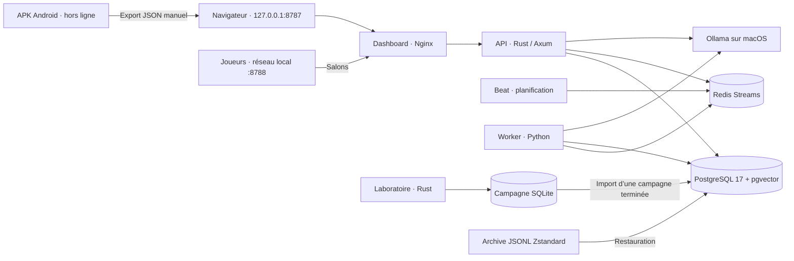

# Architecture de Lettrine

Le studio tourne sur le Mac. Docker Compose héberge le tableau de bord, l’API, PostgreSQL, Redis et les traitements en arrière-plan. Android joue hors ligne et transmet un fichier au studio quand le joueur choisit d’exporter. Le simulateur Rust peut produire ou reprendre une campagne indépendamment du studio.



## Services et ressources

| Service | Travail | Plafond RAM | Plafond CPU |
|---|---|---:|---:|
| `dashboard` | Fichiers web, compression HTTP, transfert de l’API et des téléchargements | 64 Mio | 0,5 |
| `api` | Parties, statistiques, imports, analyses, recherche, duel diffusé et téléchargements Android | 512 Mio | 2 |
| `postgres` | Métadonnées, parties simulées et importées, vecteurs | 384 Mio | 2 |
| `redis` | File de travail, résultats temporaires, signaux de vie | 96 Mio | 0,5 |
| `worker` | Commentaires Ollama et indexation du corpus | 160 Mio | 0,75 |
| `beat` | Planifie l’indexation périodique | 64 Mio | 0,25 |

Les plafonds Compose totalisent 1 280 Mio et six cœurs logiques. Ils excluent Docker Desktop, Ollama natif et les commandes de simulation ou d’entraînement lancées directement sur le Mac. Redis plafonne ses données à 48 Mio et refuse les nouvelles écritures en cas de saturation. PostgreSQL est limité à 24 connexions. L’API accepte deux analyses et deux exports simultanés, ainsi qu’un commentaire Ollama à la fois. [Configuration Compose](../compose.yaml) · [API](../src/server.rs)

Le studio de recherche écoute sur `127.0.0.1`. Pour les salons, un second port écoute sur l’IPv4 locale choisie par `tools/start.sh`. Il sert la page de jeu et l’API des salons. Le réseau privé `data` relie PostgreSQL, Redis, l’API et les services de fond. Le réseau `edge` relie Nginx, l’API et le worker. Aucun port PostgreSQL, Redis ou Axum n’est publié sur le Mac. Le secret PostgreSQL peut être fourni par `LETTRINE_DB_PASSWORD` à l’initialisation du volume. [Configuration Compose](../compose.yaml) · [Studio](../infra/dashboard.conf) · [Salons](../infra/rooms.conf.template)

## Démarrer et restaurer

Depuis la racine du dépôt, `./tools/start.sh` démarre le studio, restaure la campagne sur un volume neuf et lance les traitements. Avec Docker Desktop démarré, les services peuvent aussi être lancés directement.

```sh
docker compose up -d --build --wait
docker compose ps
curl -fsS http://127.0.0.1:8787/health
```

Le port local se règle via `LETTRINE_PORT`. Les tests de santé confirment que les services répondent. La présence des parties et des vecteurs se vérifie séparément.

`./tools/start.sh --with-social` actualise aussi le service Android des amis, des duels et du tournoi. Ce service tourne dans le projet Compose séparé `lettrine-social`, utilise son propre volume SQLite et écoute sur la boucle locale du Mac. Le port se règle via `LETTRINE_SOCIAL_PORT` et vaut `8790` par défaut. `curl -fsS http://127.0.0.1:8790/health` vérifie ce service. [Configuration du service social](../compose.social.yaml)

Le service social conserve les deux chevalets des nouveaux duels et valide le coup avec celui du joueur authentifié. Le miroir référence le duel d’origine, réutilise son plateau et inverse les chevalets. La réponse du tournoi indique si le compte a déjà terminé les trois manches d’un même week-end, ce qui permet de restaurer le fond de carte sur Android.

La bêta en ligne tourne dans un projet Compose séparé avec son propre volume. Le proxy HTTPS publie la page de connexion et l’API sociale. Le point de lecture authentifié `GET /api/social/turns` renvoie les duels qui attendent le coup du compte. Android le vérifie via WorkManager et ouvre le duel au toucher de l’alerte. [Déploiement de la bêta](../infra/README.beta.md)

Pour jouer depuis plusieurs appareils, `./tools/start.sh` utilise l’IPv4 locale du Mac. Le port de jeu se règle via `LETTRINE_LAN_PORT`. Avec `docker compose` directement, définir `LETTRINE_LAN_IP` sur l’adresse IPv4 locale à utiliser. Les joueurs ouvrent le lien d’invitation depuis ce réseau. Le navigateur récupère périodiquement l’état de la partie. Le serveur valide le tour et les mots, conserve le sac et calcule le score. Le lien identifie le salon. Un jeton individuel conservé par le navigateur donne accès à sa place et à ses lettres.

Les places des bots sont réservées à la création de la table. Le serveur calcule leur coup avec le moteur de jeu, à partir du plateau, de leur propre chevalet et des informations publiques. Lorsqu’une partie est ouverte dans un navigateur, la consultation du salon fait avancer les tours des bots. La partie reprend au même tour après une fermeture de l’onglet ou un redémarrage.

Sur un volume PostgreSQL neuf, restaurer la campagne incluse. La commande demande Python 3 et l’outil `zstd` sur le Mac.

```sh
python3 tools/import_campaign.py \
  --archive data/campaign/duels-fr-100000.jsonl.zst \
  --metadata data/campaign/metadata.json
curl -fsS http://127.0.0.1:8787/api/stats
```

La restauration charge les parties et les deux métadonnées dans une seule transaction. Elle accepte la relance sur la même campagne et refuse une campagne différente dans la même collection. Les parties importées depuis Android ont leur propre table. Le studio redirige vers l’APK de la publication GitHub de Tibop. Le dossier `android/artifacts/`, monté en lecture seule, contient le bundle Google Play archivé. Les APK compilés localement restent dans le dossier de sortie Gradle. [Import de la campagne](../tools/import_campaign.py) · [Compilation Android](../android/README.md)

## Données et provenance

- **Simulations.** `lab_games` porte les identifiants, les graines, les niveaux, les scores et le journal complet en JSONB. `lab_meta` garde le manifeste de la campagne et ses statistiques. Le corpus de référence compte 100 000 duels dont 10 000 Expert × Expert.
- **Archives historiques.** `data/expert/sample.json` conserve les parties humaines et les références sourcées, avec le dictionnaire d’époque. Le rejeu affiche les coups historiques documentés et les écarts de sources éventuels. Il garde ses statistiques indépendantes.
- **Salons web.** `web_rooms` conserve la partie en cours et le journal des tours acceptés dans le même enregistrement. Le téléchargement d’une partie terminée exige le jeton d’un participant et contient les coups publics, les sièges et les scores. Les chevalets et le sac restent privés. Les parties dont des tours précèdent cette version conservent la reprise de jeu, avec un journal incomplet.
- **Imports personnels.** `lab_imports` enregistre l’objet normalisé, un identifiant local, l’identifiant externe et une empreinte de dédoublonnage. L’import est atomique et valide la structure, les coordonnées, les types de coups et le nombre de joueurs. Il accepte les lettres Unicode sur 15 × 15 et ne recalcule pas la légalité lexicale ni les scores déclarés.
- **Recherche.** `lab_vectors` contient les documents indexés, leur source et un vecteur de 1 024 dimensions. Cet index se reconstruit à partir des données et de la documentation. Les parties personnelles en sont exclues.

[Schéma](../infra/schema.sql) · [Archives](../data/expert/README.md) · [Validation des imports](../src/import.rs)

## API locale

Les coordonnées des jetons sont des entiers de 0 à 14, ligne puis colonne. Les tours commencent à 1 et les sièges à 0. Un jeton placé porte `letter` et `blank`. Une partie simulée détaillée contient le journal `moves`, les scores ajustés et les informations de fin.

| Route | Résultat |
|---|---|
| `GET /api/stats` | Totaux, Elo relatif, matrice des duels, mots fréquents, progression, lexique et stockage |
| `GET /api/games?elite=1&limit=20&offset=0` | Résumés paginés et total. `elite=1` cible Expert × Expert, `level=3` cible tout duel avec Expert, `q` filtre par identifiant ou graine |
| `GET /api/games/{id}` | Rejeu complet d’un duel simulé |
| `GET /api/games/{id}/review?turn=N` | Revue déterministe du tour avec score, meilleur score immédiat et variantes évaluées |
| `GET /api/games/{id}/challenge?turn=N` | Commentaire facultatif du modèle local sur les résultats de la revue |
| `GET /api/live?seed=123&a=3&b=3` | Flux SSE `start`, `move`, `done` pour un duel généré à la demande |
| `GET /api/export?format=jsonl&elite=1` | Export de simulations, avec filtres identiques à la liste. Formats JSONL, JSON et CSV de résumé |
| `POST /api/import` | Corps brut JSON ou JSONL, jusqu’à 32 Mio, renvoie `imported` et `duplicates` |
| `GET /api/imports` et `GET /api/imports/{id}` | Historique paginé des imports et détail d’une partie |
| `GET /api/imports/export?format=json` | Export des imports au format JSON ou JSONL |
| `GET /api/rooms/{code}/replay` | Journal JSON d’un salon terminé disposant de tous ses tours, accessible aux participants |
| `GET /api/expert` | Archives historiques et références |
| `GET /api/models` et `GET /api/profiles` | Résultats d’entraînement et profils de langues |
| `GET /api/llm-benchmarks` | Duels pilotes par modèle Ollama, adversaire, taille et intervalle |
| `GET /api/adaptive?elo=1200` | Niveau le plus proche selon les cotes de la campagne et score attendu |
| `GET /api/search?q=jouer+le+joker` | Jusqu’à huit extraits et leurs sources, classés par similarité cosinus |
| `GET /download/lettrine.apk` | Redirection vers l’APK de Tibop sur GitHub, ou APK local si `LETTRINE_APK` indique un fichier |
| `GET /download/lettrine.aab` | Bundle Android WordRivet 0.16.4 signé pour Google Play |

```sh
curl -fsS 'http://127.0.0.1:8787/api/games/100000/review?turn=1'
curl -N 'http://127.0.0.1:8787/api/live?seed=123&a=3&b=3'
curl -fsS 'http://127.0.0.1:8787/api/export?format=jsonl&elite=1' -o experts.jsonl
curl -fsS --data-binary @historique-android.json http://127.0.0.1:8787/api/import
```

Le flux SSE affiche progressivement un duel calculé avant la diffusion. Il reste éphémère et peut être exporté puis importé. L’API reçoit des fichiers de parties Android terminées. Elle ne relaie pas les parties Android en cours. [Routes](../src/server.rs) · [Interface web](../web/app.js)

## Redis, pgvector et Ollama

Le commentaire et l’indexation sont deux tâches de la même file Redis Stream, `lettrine:jobs`. Le groupe `lettrine:workers` lit les nouvelles entrées et reprend les messages en attente depuis trois minutes. Le worker écrit le résultat, acquitte puis retire le message dans une transaction Redis. Les résultats expirent après 15 minutes. En cas d’arrêt avant l’acquittement, le traitement peut recommencer. L’indexation utilise des identifiants stables et des mises à jour idempotentes.

Beat réserve une fenêtre d’indexation avec un verrou Redis et propose une tâche au démarrage, puis toutes les 15 minutes par défaut. Le worker et beat renouvellent leurs signaux de vie toutes les cinq secondes, avec expiration à 30 secondes. Redis conserve sa file sur le volume `redis_data` par journalisation append-only et synchronisation disque chaque seconde. L’API attend le résultat d’un commentaire jusqu’à 87 secondes. Si la réponse Ollama est indisponible ou invalide, le studio affiche le commentaire du moteur et indique la cause. [Worker et planificateur](../infra/job_runner.py) · [Configuration Redis](../compose.yaml)

Ollama s’exécute sur macOS. Les conteneurs appellent `http://host.docker.internal:11434` par défaut. `LETTRINE_OLLAMA_MODEL` choisit le modèle de commentaire, `llama3.2:3b` par défaut. `LETTRINE_EMBED_MODEL` choisit le modèle d’index, `qwen3-embedding:0.6b` par défaut, avec une sortie de 1 024 valeurs. Après un changement de modèle, la réindexation doit se terminer avant de comparer les résultats. [Configuration Ollama](../compose.yaml) · [Schéma pgvector](../infra/vector.sql)

```sh
ollama pull llama3.2:3b
ollama pull qwen3-embedding:0.6b
docker compose logs --tail=30 worker beat
curl -fsS --get --data-urlencode 'q=jouer le joker' http://127.0.0.1:8787/api/search
```

Le corpus de recherche comprend la documentation, les archives humaines et une sélection de positions de duels simulés Expert. Ollama choisit l’angle du commentaire parmi le score immédiat, le reliquat et la marge simulée. Le moteur vérifie ce choix puis rédige le commentaire à partir des scores, des lettres et des marges de la revue. Les scores, la validation des mots, les bots et le rejeu fonctionnent indépendamment d’Ollama.

## Rejouer et entraîner le laboratoire

```sh
LETTRINE_DB=results/reproduction-fr.sqlite \
  LETTRINE_GAMES=100000 LETTRINE_SEED=20261112 cargo run --release --locked -- run
LETTRINE_DB=results/reproduction-fr.sqlite cargo run --release --locked -- stats
cargo run --release --locked -- train results/politique-test.json
```

La simulation utilise des graines reproductibles et enregistre par lots le journal compressé et les compteurs dans SQLite. Une exécution relancée avec la même configuration reprend les identifiants manquants. Le manifeste fixe la graine, le profil et le SHA-256 du dictionnaire. Les duels en direct à niveaux fixes rejouent les quatre politiques de la campagne. NAB à niveau réglable utilise la calibration du profil lorsqu’elle est disponible. La recherche avancée française se choisit dans son propre mode, avec l’Expert entraîné comme adversaire par défaut. Son évaluation repose sur des duels réservés, avec un résultat de match plutôt qu’une cote absolue.

L’entraînement ajuste les poids de la politique Expert par autojeu, avec les deux sièges joués sur chaque graine. La sélection et le test utilisent des graines distinctes. La revue de coups teste des variantes et leurs réponses sur trois demi-coups, à partir des jetons inconnus échantillonnés. [Résultats](RESULTATS.md) · [Méthode](ENTRAINEMENT.md) · [Manifeste de la politique](../data/models/fr-bots-v1.json)

## Android et versions de jeu

Android utilise un moteur natif Java et des lexiques embarqués pour le français et l’anglais. Le jeu sur un seul téléphone masque le chevalet au changement de siège. Le Bluetooth classique demande deux appareils déjà associés et compatibles en version de protocole et en empreinte de lexique. L’hôte valide les actions et tient le sac. Il transmet à l’invité son chevalet et l’état public, avec le nombre de jetons dans le sac et les coups sans chevalets adverses. Après une coupure, les deux applications reprennent la partie gardée en mémoire à l’aide de son identifiant et de l’adresse du partenaire associé. L’hôte renvoie l’état public et le chevalet de l’invité. Un brouillon en attente reste disponible sur le même tour. [Android](../android/README.md)

Les parties locales et solo reprennent après fermeture. Le réarrangement du chevalet est enregistré pour le tour courant comme un ordre d’affichage. Les indices des tuiles utilisés par le moteur et par les poses en brouillon restent les mêmes. Les parties terminées, statistiques et cotes Android restent dans le stockage de l’application jusqu’à un export volontaire. Le mode adaptatif utilise la cote locale et l’écart en cours. Les cotes du studio et celles du téléphone s’étalonnent séparément.

Le lexique **Grammalecte 7.7 · Classique** partage le trie de Grammalecte 7.7. Un masque d’exclusions s’applique à la validation et à la recherche de coups de NAB. Le jeu inscrit l’empreinte utilisée dans la sauvegarde, le résultat et l’identité des nouveaux liens de défi du jour. Les anciennes sauvegardes sans empreinte gardent la liste d’origine. Le Bluetooth et le studio utilisent le lexique d’origine. Les poids entraînés du niveau Maître restent liés à l’empreinte de référence. [Construction et versionnement](../data/fr/README.md#lexique-des-nouvelles-parties-classiques-sur-android)

Le service social garde l’identité des plateaux et tirages du catalogue. Les clients Android compatibles annoncent l’empreinte du lexique filtré. Le serveur mémorise cette prise en charge par joueur et fixe le lexique de chaque nouveau duel. Les revanches miroir héritent du lexique du duel d’origine. Les nouvelles opérations emploient des tables SQLite ajoutées à l’ouverture de la base, et les invitations existantes conservent leur jeton. L’empreinte facultative dans les données du plateau annonce les règles de validation. [Guide d’exploitation](../infra/README.beta.md)

Le client garde localement l’invitation en attente par langue et serveur et le brouillon d’un duel par compte et plateau. Après une erreur d’envoi, il relit l’état du duel pour vérifier si le coup a été enregistré. Un renvoi du même coup est idempotent. Une revanche déjà terminée renvoie ses placements publics dans la réponse d’origine ou de renvoi.

L’APK inclut SmolLM2 135M Instruct en 4 bits et llama.cpp. Une tâche Android dédiée évalue la réponse du modèle parmi les angles d’explication disponibles. Le moteur Java reconstruit le score à partir du journal et rédige le texte dans la langue du jeu. Le commentaire fonctionne sans connexion pendant une partie ou dans l’historique. Le modèle reçoit les faits du moteur, sans les lettres des chevalets privés. [Modèle et licences](../android/app/src/main/assets/SmolLM2-NOTICE.md)

Le bilan d’une partie terminée reconstruit le plateau tour par tour et calcule des placements alternatifs quand le journal contient le chevalet et que le lexique est compatible. Le moteur contrôle leur légalité et compare les points immédiats. L’écran de résultat met en avant une tactique vérifiable avec ses cases lorsqu’un placement apporte un gain. Le bilan détaillé affiche jusqu’à trois tours. Les parties Bluetooth utilisent les coups publics. La courbe d’Elo lit les cotes enregistrées des parties solo cotées sans recalculer les résultats.

Le premier défi utilise une position préparée et la validation habituelle des coups. Pour retenter un tour du bilan, l’exercice reprend une copie du plateau avant le coup et du chevalet enregistré. La tentative et la comparaison restent en mémoire. Le moteur de partie, l’historique et la cote ne sont pas modifiés.

Le défi quotidien détermine sa position à partir du jour civil local et vérifie sa proposition avec le lexique embarqué. La date est fixée à l’ouverture du défi. Les préférences locales gardent le meilleur score de chaque jour validé et calculent la série à partir des jours consécutifs. Le partage Android joint une carte PNG et un lien d’invitation versionné. Le lien contient la date, le score et une empreinte du lexique, du plateau et du chevalet. La page statique publiée depuis `android/share-site/defi/` sur la branche `gh-pages` lit les paramètres dans le fragment et ouvre le lien Android. Le destinataire peut ensuite jouer hors ligne, y compris pour une autre date. Une autre date n’est pas inscrite dans la série locale.

Les profils de jeu versionnés regroupent géométrie, jetons, conditions de fin, lexique et orthographe. Les profils classiques français, anglais, allemand et russe fournissent chacun un lexique libre. Le profil japonais documente une mécanique propre. Un profil incompatible ou un lexique différent empêche de recalculer les variantes d’une campagne. Les archives historiques conservent leurs éditions de référence. [Profils de langue](LANGUES.md)
